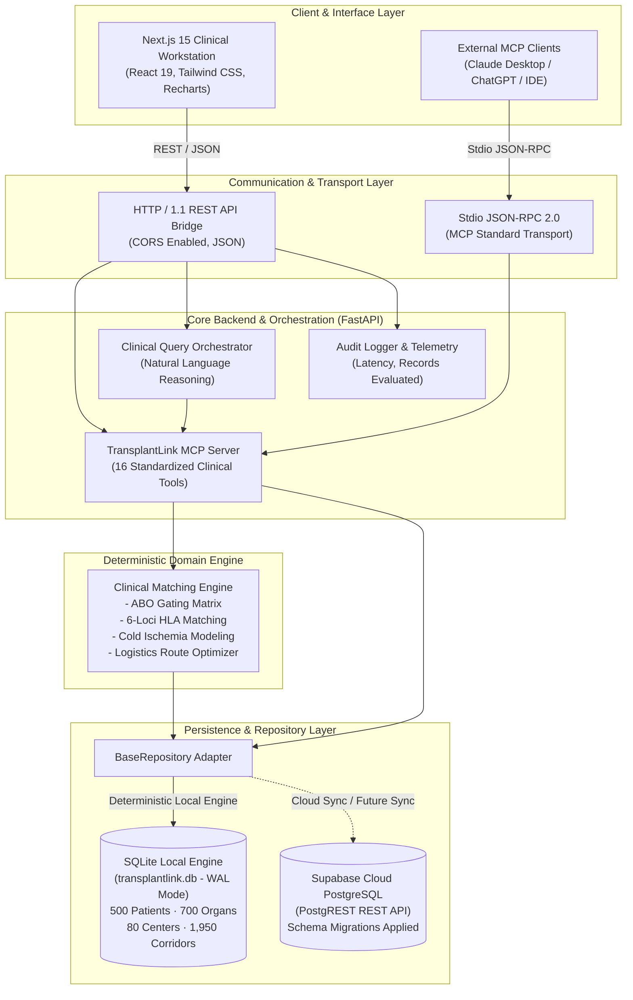
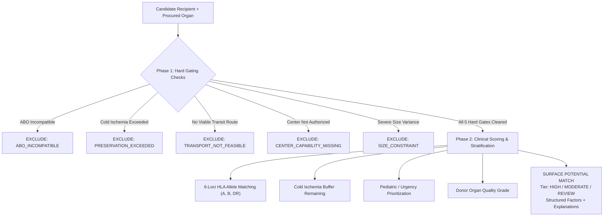

# TransplantLink: Technical Architecture & System Specification

> **NOTICE**: Prototype operating exclusively on **synthetic demonstration data** for clinical decision-support research.
> *The MCP server retrieves and computes. The AI explains. The frontend visualizes. The clinician makes the decision.*

---

## 1. Executive Summary & System Philosophy

**TransplantLink** is an intelligent clinical decision-support workstation designed for organ transplant coordinators, retrieval teams, and transplant surgeons. It unifies distributed donor registries, logistical transport networks, cold ischemia preservation monitoring, and immunological histocompatibility matching under a standardized, protocol-driven architecture.

### Architectural Philosophy
Traditional transplant coordination suffers from siloed electronic health record (EHR) systems, fragmented communication with air/ground transit coordinators, and opaque priority scoring. TransplantLink resolves this through three core principles:
1. **Deterministic Clinical Gating**: Critical clinical rules (ABO compatibility, cold ischemia time limits, center accreditation) are evaluated deterministically—never left to probabilistic LLM hallucination.
2. **Model Context Protocol (MCP) Standard**: Clinical data access and algorithm evaluations are exposed as standardized MCP tools, enabling any compliant client (Next.js frontend, ChatGPT, Claude Desktop, Antigravity IDE) to interact with the registry safely.
3. **Transparent Clinical Decision Support**: Every matching outcome produces structured positive factors ("Why?") and categorized exclusion reasons ("Why Not?"), accompanied by an immutable audit trail.

---

## 2. System Architecture & Topology



---

## 3. Technology Stack Breakdown

| Layer | Technology | Version | Purpose / Responsibilities |
| :--- | :--- | :--- | :--- |
| **Frontend Framework** | **Next.js** (App Router) | `15.1.6` | Server and client components, routing, fast page rendering. |
| **UI Library** | **React** | `19.0.0` | Declarative UI, state management, client hooks. |
| **Styling & Icons** | **Tailwind CSS** + **Lucide React** | `3.4.17` / `0.474.0` | Dense, high-information medical aesthetic; clinical icons. |
| **Data Visualization** | **Recharts** | `2.15.1` | Interactive charts (inventory, scatter distance vs. ETA, time trends). |
| **Backend Framework** | **FastAPI** | `0.136.1` | High-performance asynchronous API, auto-generated OpenAPI/Swagger. |
| **ASGI Web Server** | **Uvicorn** | `0.47.0` | High-concurrency ASGI server running on port `8000`. |
| **Protocol Layer** | **Model Context Protocol (MCP)** | `2.2.0` | Standard tool specification for agentic workflows & clinical inspection. |
| **Data Validation** | **Pydantic** | `2.13.4` | Strict type schema validation for MCP arguments and API payloads. |
| **Primary Persistence** | **SQLite (WAL Mode)** | `3.x` | Embedded zero-latency relational engine with JSON extraction. |
| **Cloud Persistence** | **Supabase (PostgreSQL)** | `Postgres 15` | Managed cloud PostgreSQL with PostgREST REST interface and JWT security. |
| **Language Environments**| **Python** / **Node.js** | `3.14` / `v20+` | Dual-runtime execution environment. |

---

## 4. Communication Protocols

TransplantLink implements dual communication protocols to serve both web applications and autonomous AI agents:

### 1. HTTP / RESTful API (Web Client Communication)
* **Transport**: HTTP/1.1 over TCP.
* **Content Type**: `application/json; charset=utf-8`.
* **CORS Policy**: Configured in [`backend/server.py`](file:///d:/vishal/OrganOs/backend/server.py#L35-L40) with `allow_origins=["*"]`, `allow_methods=["*"]`, and `allow_headers=["*"]`.
* **Fault Tolerance**: The frontend API client ([`frontend/src/lib/api.ts`](file:///d:/vishal/OrganOs/frontend/src/lib/api.ts)) implements synthetic fallback structures ensuring uninterrupted operation during network or backend reboots.

### 2. JSON-RPC 2.0 via Stdio (Model Context Protocol Standard)
* **Transport**: Standard Input/Output (`stdio`) streams.
* **Specification**: Model Context Protocol (MCP) by Anthropic / Open Source Standard.
* **Runner Script**: [`backend/run_mcp_stdio.py`](file:///d:/vishal/OrganOs/backend/run_mcp_stdio.py).
* **Wire Format**:
  ```json
  {
    "jsonrpc": "2.0",
    "id": 1,
    "method": "tools/call",
    "params": {
      "name": "find_potential_matches",
      "arguments": {
        "patient_id": "REC-2026-00421",
        "organ_type": "Kidney"
      }
    }
  }
  ```

---

## 5. Model Context Protocol (MCP) Server Specification

The MCP Server is implemented in [`backend/mcp_server.py`](file:///d:/vishal/OrganOs/backend/mcp_server.py) using the official `mcp.server.mcpserver.MCPServer` abstraction. It exposes **16 clinical tools** across five functional domains:

```
                          ┌───────────────────────────┐
                          │ TransplantLink MCP Server │
                          └─────────────┬─────────────┘
                                        │
      ┌─────────────────┬───────────────┼───────────────┬─────────────────┐
      ▼                 ▼               ▼               ▼                 ▼
[ Patient Tools ] [ Organ/Donor ]  [ Matching ]   [ Hospital/Log ]  [ Preservation ]
• get_patient     • search_organs  • evaluate_    • get_hospital    • preservation_
• search_patients • organ_details    compatibility• find_centers      status
• get_waitlist    • get_donor      • find_matches • transport_opts  • registry_stats
                  • donor_organs                  • transport_eta   • match_stats
```

### Complete Tool Directory

#### Group A: Patient & Waitlist Tools
1. `get_patient(patient_id: str)`:
   * **Description**: Retrieves full clinical profile, 6-loci HLA alleles (A, B, DR), PRA%, urgency score, and listing hospital.
   * **Parameters**: `patient_id` (e.g. `"REC-2026-00421"`).
2. `search_patients(organ_needed, blood_group, urgency_level, listing_status, query, limit)`:
   * **Description**: Multi-parameter search across candidate waitlists.
3. `get_waitlist()`:
   * **Description**: Aggregated census of waitlist candidates broken down by organ type and urgency status.

#### Group B: Organ & Procured Donor Tools
4. `search_available_organs(organ_type, blood_group, location, limit)`:
   * **Description**: Searches currently procured organs undergoing active preservation.
5. `get_organ_details(organ_id: str)`:
   * **Description**: Comprehensive physiological metrics (e.g., eGFR, warm/cold ischemia times, biopsy score).
6. `get_donor(donor_id: str)`:
   * **Description**: Demographics, medical screening history, infectious disease markers, and HLA profile.
7. `get_donor_organs(donor_id: str)`:
   * **Description**: All organs procured from a single donor.

#### Group C: Matching Engine Tools
8. `evaluate_compatibility(patient_id: str, organ_id: str)`:
   * **Description**: Performs deterministic clinical evaluation of a specific recipient-donor pair. Produces positive and limiting factors.
9. `find_potential_matches(patient_id: str, organ_type: Optional[str])`:
   * **Description**: The core algorithm tool. Evaluates all candidate organs against a recipient, returning surfaced matches, excluded candidates, and full categorized exclusion counts.

#### Group D: Hospital & Logistics Tools
10. `get_hospital(hospital_id: str)`:
    * **Description**: Center accreditation, ICU beds, HLA lab status, and authorized organ transplant programs.
11. `find_transplant_centers(organ_type: Optional[str], location: Optional[str])`:
    * **Description**: Locates authorized medical centers certified for designated organ programs.
12. `find_transport_options(organ_id: str, destination_hospital_id: str)`:
    * **Description**: Calculates available multi-modal transit routes (dedicated ambulance, scheduled air, chartered medical flight) with distance and ETAs.
13. `calculate_transport_eta(transport_id: str)`:
    * **Description**: Granular transit countdown and waypoint breakdown.

#### Group E: Preservation & Registry Analytics Tools
14. `get_preservation_status(organ_id: str)`:
    * **Description**: Calculates cold ischemia elapsed time, preservation method (Static Cold Storage vs. Pulsatile Machine Perfusion), and remaining viable margin.
15. `get_registry_statistics()`:
    * **Description**: System-wide dashboard metrics: active candidates, available organs, active routes, and preservation urgency states.
16. `get_match_statistics(patient_id: str)`:
    * **Description**: Individual candidate allocation metrics and historical candidate ratios.

---

## 6. Clinical Matching Engine Algorithms

Implemented in [`backend/matching_engine.py`](file:///d:/vishal/OrganOs/backend/matching_engine.py), the engine evaluates candidate pairs through a **two-phase deterministic evaluation pipeline**:



### Hard Gating Specifications
1. **ABO Compatibility Matrix**:
   * Donors $O^-$ are universal donors; recipients $AB^+$ are universal recipients.
   * Rh factor compatibility is enforced in high-risk thoracic allocations.
2. **Maximum Safe Preservation Windows**:
   * **Heart**: $5.0 \text{ hours}$ max
   * **Lung**: $7.0 \text{ hours}$ max
   * **Liver**: $14.0 \text{ hours}$ max
   * **Pancreas**: $15.0 \text{ hours}$ max
   * **Kidney**: $30.0 \text{ hours}$ max
3. **Logistics & Transit Safety**:
   $$\text{Remaining Buffer} = \text{Max Window} - (\text{Elapsed Preservation} + \text{Transit ETA}) > 0$$
4. **Center Program Authorization**:
   * Receiving hospital must have active accreditation in `transplant_programs` for the specific organ.

### Benchmark Canonical Scenario
The engine guarantees the following reproducible benchmark for recipient `REC-2026-00421`:
* **Total Organs Considered**: 27 available kidneys
* **Potential Matches Surfaced**: 8
* **Excluded Candidates**: 19
  * 8 ABO Incompatible
  * 4 Transport Not Feasible
  * 3 Preservation Window Exceeded
  * 2 Center Capability Missing
  * 2 Size Variance ($>30\%$ discrepancy)

---

## 7. Complete API Endpoint Reference

All REST endpoints are hosted on `http://127.0.0.1:8000`.

### 1. Model Context Protocol Bridge
* **`GET /api/mcp/tools`**
  * **Summary**: Enumerate all 16 registered clinical tools with docstrings and parameter signatures.
  * **Response**: `{"tools": [{"name": "find_potential_matches", "doc": "..."}]}`
* **`POST /api/mcp/call`**
  * **Summary**: Execute an MCP tool by name with arguments.
  * **Request Body**:
    ```json
    {
      "tool": "find_potential_matches",
      "arguments": { "patient_id": "REC-2026-00421", "organ_type": "Kidney" }
    }
    ```
  * **Response**:
    ```json
    {
      "tool": "find_potential_matches",
      "latency_ms": 184,
      "result": { "potential_matches": 8, "excluded_candidates": 19, ... },
      "disclaimer": "SYNTHETIC DATA · DEMONSTRATION PROTOTYPE"
    }
    ```

### 2. Clinical Reasoning & Natural Language Query
* **`POST /api/query`**
  * **Summary**: Accepts coordinator natural language clinical queries, parses intent, executes underlying MCP tools, and synthesizes structured clinical evidence.
  * **Request Body**:
    ```json
    { "query": "Find matching kidneys for REC-2026-00421 that can arrive within safe preservation window" }
    ```
  * **Response**:
    ```json
    {
      "query": "...",
      "patient_id": "REC-2026-00421",
      "organ_type": "Kidney",
      "answer": "**SEARCH RESULT**\nEvaluated **27 available kidneys**...",
      "data_sources_consulted": [
        { "tool": "get_patient", "records_evaluated": 1, "latency_ms": 2 },
        { "tool": "search_available_organs", "records_evaluated": 27, "latency_ms": 15 },
        { "tool": "find_potential_matches", "records_evaluated": 27, "latency_ms": 128 }
      ],
      "matches": [ ... ],
      "latency_ms": 156
    }
    ```

### 3. Patient Waitlist Registry
* **`GET /api/patients`**
  * **Query Params**: `organ_needed`, `blood_group`, `urgency_level`, `listing_status`, `query`, `limit`, `offset`
  * **Response**: `{"total": 500, "patients": [ ... ]}`
* **`GET /api/patients/{patient_id}`**
  * **Response**: Individual patient clinical record including HLA alleles and center profile.

### 4. Organ Inventory & Procurements
* **`GET /api/organs`**
  * **Query Params**: `organ_type`, `blood_group`, `status`, `preservation_status`, `limit`, `offset`
  * **Response**: `{"total": 700, "organs": [ ... ]}`
* **`GET /api/organs/{organ_id}`**
  * **Response**: Organ metrics, preservation countdown, donor ID, and donor hospital.

### 5. Matching & Compatibility
* **`POST /api/matching/find-potential`**
  * **Request Body**: `{"patient_id": "REC-2026-00421", "organ_type": "Kidney"}`
  * **Response**: Full matching payload with matches, exclusions, and breakdown.
* **`POST /api/matching/evaluate`**
  * **Request Body**: `{"patient_id": "REC-2026-00421", "organ_id": "SYN-ORG-9921"}`
  * **Response**: Comprehensive pair evaluation report and audit record ID.

### 6. Logistics & Center Facilities
* **`GET /api/hospitals`**
  * **Query Params**: `organ_program`, `city`, `limit`
  * **Response**: `{"hospitals": [ ... ]}`
* **`GET /api/hospitals/{hospital_id}`**
  * **Response**: Center details, ICU beds, HLA lab presence, and coordinates.
* **`GET /api/logistics/routes`**
  * **Query Params**: `origin`, `destination`
  * **Response**: Multi-modal route options (road, air), distance in km, and projected minutes.

### 7. Executive Analytics & Audit Trails
* **`GET /api/analytics/registry`**
  * **Summary**: Executive metrics: candidate count, available organs, routes, and urgency buckets.
* **`GET /api/analytics/charts`**
  * **Summary**: Five structured datasets formatted for frontend Recharts consumption.
* **`GET /api/audit`**
  * **Query Params**: `limit`
  * **Summary**: Immutable chronological log of all tool executions, user queries, evaluated counts, and latencies.

---

## 8. Database Schema & Data Models

The system supports both SQLite (embedded zero-latency WAL mode) and Supabase (cloud PostgreSQL via [`supabase/migrations/01_initial_schema.sql`](file:///d:/vishal/OrganOs/supabase/migrations/01_initial_schema.sql)):

```
┌──────────────────┐       1:1       ┌──────────────────┐
│     patients     │ ─────────────── │   patient_hla    │
│ patient_id (PK)  │                 │ patient_id (FK)  │
└────────┬─────────┘                 └──────────────────┘
         │ N:1
         ▼
┌──────────────────┐       N:1       ┌──────────────────┐
│    hospitals     │ ◄────────────── │      organs      │
│ hospital_id (PK) │                 │ organ_id (PK)    │
└──────────────────┘                 └────────┬─────────┘
                                              │ N:1
                                              ▼
┌──────────────────┐       1:1       ┌──────────────────┐
│    donor_hla     │ ─────────────── │      donors      │
│ donor_id (FK)    │                 │ donor_id (PK)    │
└──────────────────┘                 └──────────────────┘
```

### Table Definitions
1. **`patients`**: Recipient demographics, blood group, height/weight, organ needed, listing urgency, PRA%, and hospital reference.
2. **`patient_hla`**: 6-loci alleles (`hla_a_1`, `hla_a_2`, `hla_b_1`, `hla_b_2`, `hla_dr_1`, `hla_dr_2`).
3. **`donors`**: Deceased/living donor records, cause of death, screening labs, age, sex.
4. **`donor_hla`**: Donor 6-loci HLA alleles.
5. **`organs`**: Procured organs, anatomical type, preservation method, procurement timestamp, quality scores.
6. **`hospitals`**: 80 medical centers with geocoordinates, ICU capacities, and certified programs.
7. **`logistics_routes`**: 1,950 pre-computed ground ambulance and flight paths between all center pairs.
8. **`allocation_events`**: 2,149 longitudinal records tracking historical decisions (OFFERED, ACCEPTED, DECLINED, EXPIRED, TRANSPLANTED).

---

## 9. Security, Compliance & Audit Trail

1. **Synthetic Isolation**: All names, identifiers, and clinical metrics are algorithmically generated (Seed `20260914`). No protected health information (PHI) or real-world patient records exist within the system.
2. **Cryptographic Record Verification**: Every allocation and audit event computes an SHA-256 hash across entity identifiers, timestamp, and evaluation output to ensure tamper evidence.
3. **Clinical Guardrails**: Every MCP tool response and API payload includes the mandatory banner:
   ```
   SYNTHETIC DATA · DEMONSTRATION PROTOTYPE ONLY
   ```
4. **Decision Boundary**: The software strictly functions in a **decision-support capacity**. Gating recommendations provide evidence for human coordinators; no automatic allocations or irreversible surgical assignments are executed autonomously.
